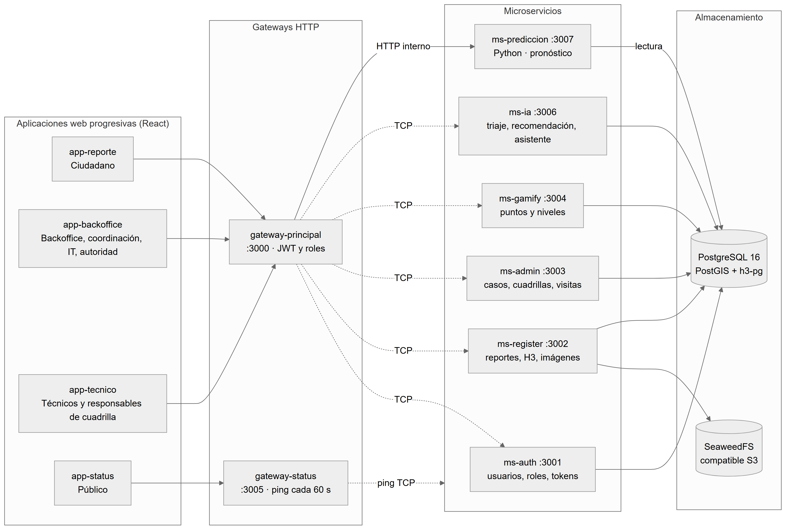
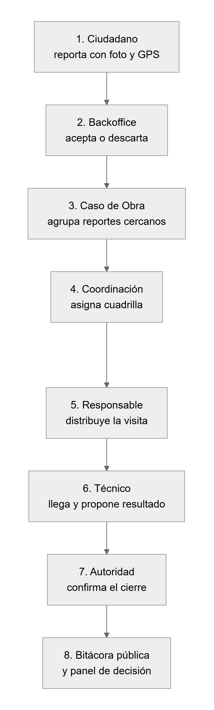

# Arquitectura del sistema {#arquitectura}

## Visión general

Ojo Camba sigue una arquitectura de microservicios organizada en un monorepo. Las aplicaciones cliente se
comunican por HTTP con dos gateways; el gateway principal comprueba la sesión y los roles y reenvía cada
pedido al microservicio que corresponde por TCP. El único servicio que no habla TCP es el de predicción,
escrito en Python, al que el gateway llega por HTTP interno y que no se publica con dominio propio
(@figura:arquitectura).

{#arquitectura ancho=16}

Nota: Las líneas punteadas son llamadas TCP entre servicios; las continuas, HTTP o acceso a datos.

El recorrido de un problema urbano atraviesa varios de esos componentes, desde que el ciudadano lo reporta
hasta que la autoridad confirma su cierre (@figura:flujo).

{#flujo ancho=6}

## Servicios de backend

El backend reúne dos gateways HTTP construidos con NestJS sobre Fastify, cinco microservicios NestJS
comunicados por TCP y un microservicio de predicción en Python (@tabla:servicios). Los contratos entre el
gateway y los microservicios son 82 patrones de mensaje definidos en una librería compartida, con el formato
`dominio.accion`; cada patrón tiene su manejador en el microservicio correspondiente.

Tabla: Servicios de backend {#servicios anchos=3.6,2.6,1.4,8.4}

| Servicio | Tecnología | Puerto | Responsabilidad |
|----------|------------|-------:|-----------------|
| gateway-principal | NestJS, HTTP | 3000 | Punto de entrada de las aplicaciones: autenticación JWT, control por rol, eventos en tiempo real con Socket.IO y proxy hacia la predicción |
| gateway-status | NestJS, HTTP | 3005 | Consulta cada 60 segundos el estado de los microservicios, guarda el historial y lo publica |
| ms-auth | NestJS, TCP | 3001 | Usuarios, roles, inicio de sesión, tokens de renovación y gestión de accesos |
| ms-register | NestJS, TCP | 3002 | Registro de reportes, cálculo de los índices H3, subida de imágenes y mapa de calor |
| ms-admin | NestJS, TCP | 3003 | Moderación, Casos de Obra, cuadrillas, visitas, bitácora, indicadores y decisiones sobre el pronóstico |
| ms-gamify | NestJS, TCP | 3004 | Puntos por reporte aceptado y niveles de participación |
| ms-ia | NestJS, TCP | 3006 | Triaje de gravedad, recomendación de cuadrillas y asistente con modelos de lenguaje |
| ms-prediccion | Python, FastAPI | 3007 | Entrenamiento, comparación de modelos, pronóstico de demanda y alertas de capacidad |

## Almacenamiento e índice espacial

Los datos se guardan en PostgreSQL 16 con las extensiones PostGIS y h3-pg. Las imágenes de los reportes y de
la bitácora se guardan en SeaweedFS, un almacenamiento de objetos compatible con la API de S3.

Cada reporte se indexa en tres resoluciones del índice H3 (Brodsky, 2018): 8, 11 y 13. La resolución 8, con
celdas del tamaño de un barrio, alimenta el mapa de calor y el pronóstico por zona; la 11 sirve para reconocer
al aceptar un reporte el Caso de Obra activo de la misma zona y para medir la recurrencia; la 13 conserva la
ubicación con precisión de pocos metros. La sugerencia de reportes duplicados y la búsqueda de casos cercanos
a un técnico usan la distancia física —por defecto 100 y 300 metros, respectivamente— y no la igualdad de
celda: un mismo problema puede caer en dos hexágonos vecinos, y el moderador decide.

## Aplicaciones cliente

Las cuatro aplicaciones son aplicaciones web progresivas construidas con React 18, Vite 6 y Tailwind CSS 4
(@tabla:frontends).

Tabla: Aplicaciones cliente {#frontends anchos=3.4,4.6,8}

| Aplicación | Usuarios | Funciones principales |
|------------|----------|-----------------------|
| app-reporte | Ciudadanos | Captura de foto con cámara y GPS obligatorios, mapa de calor, seguimiento y bitácora pública del reporte |
| app-backoffice | Backoffice, coordinación, encargado IT, autoridad | Bandeja de moderación en tiempo real, Casos de Obra, cuadrillas, tablero estratégico, panel de decisión y configuración de IA |
| app-tecnico | Técnicos y responsables de cuadrilla | Ruta diaria, distribución de visitas, llegada con GPS, bitácora de obra y resultado de la visita |
| app-status | Público | Estado y disponibilidad histórica de cada microservicio |

## Sistema de diseño

Las interfaces siguen el sistema de diseño propio «Anillos», inspirado en Santa Cruz de la Sierra: una paleta
cálida de tonos tierra sobre un fondo crema (con nombres como Catedral, Ladrillo y Rosa Toborochi), una única
tipografía, Piraí Sans, y bordes muy redondeados —36 píxeles en tarjetas y botones— que evocan los anillos de
la ciudad. Todo se diseña primero para teléfonos de 375 a 428 píxeles de ancho.
