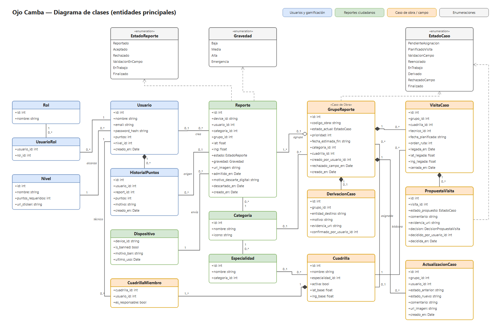
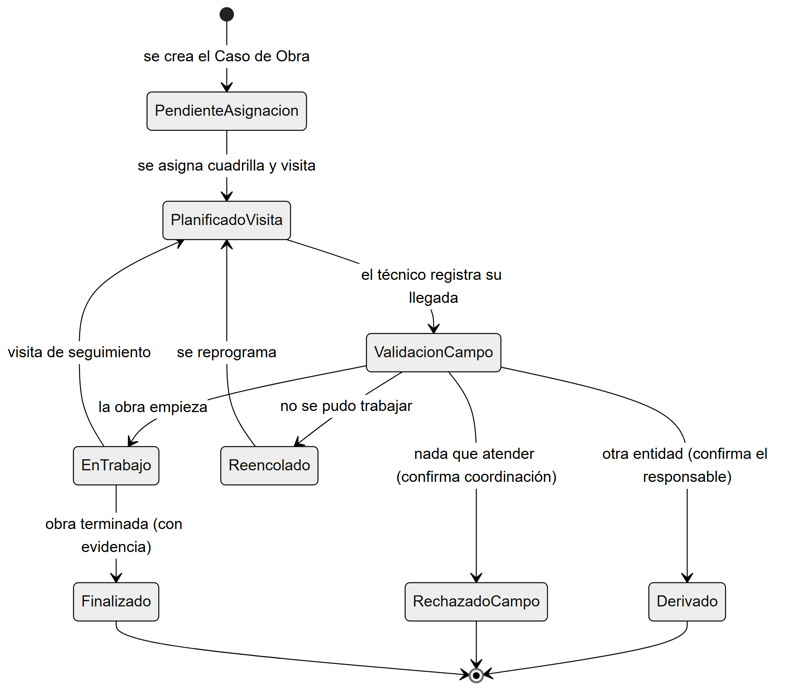

# Modelo de datos {#modelo-datos}

## Entidades

La base de datos tiene veintitrés tablas, definidas como entidades TypeORM en una librería compartida por
todos los servicios (@tabla:entidades). La @figura:clases muestra las entidades principales y sus
relaciones.

Tabla: Tablas de la base de datos por dominio {#entidades anchos=3.6,6.2,6.2}

| Dominio | Tablas | Propósito |
|---------|--------|-----------|
| Usuarios y acceso | `usuarios`, `roles`, `usuario_roles`, `refresh_tokens`, `solicitudes_ti`, `solicitud_ti_usuarios` | Cuentas, roles, sesiones y solicitudes de cambios de acceso atendidas por el encargado IT |
| Reportes ciudadanos | `reportes`, `dispositivos`, `categorias` | Reportes con foto, ubicación e índices H3; dispositivos anónimos y su bloqueo; catálogo de categorías |
| Casos y operación de campo | `grupos_reportes`, `actualizaciones_caso`, `cuadrillas`, `cuadrilla_miembros`, `especialidades`, `visitas_caso`, `propuestas_visita`, `derivaciones_caso`, `configuracion_operativa` | Casos de Obra, bitácora, cuadrillas con su responsable, visitas, propuestas de resultado, derivaciones y umbrales de capacidad |
| Gamificación | `niveles`, `historial_puntos` | Niveles de participación y puntos otorgados por reporte aceptado |
| Predicción | `decisiones_recomendacion` | Decisiones del coordinador sobre las alertas, con una copia de la recomendación mostrada |
| Plataforma | `ping_log`, `ai_provider_configs` | Historial de disponibilidad de los servicios y proveedores de inteligencia artificial con sus claves cifradas |

{#clases ancho=16}

Nota: Colores por dominio: azul, usuarios y gamificación; verde, reportes ciudadanos; naranja, Caso de Obra y
operación de campo; gris, enumeraciones.

Un reporte puede enviarse sin cuenta: se identifica con el identificador anónimo del dispositivo, que luego
puede vincularse a una cuenta para recuperar el historial. Un Caso de Obra agrupa uno o más reportes del
mismo problema bajo un código único con el formato `O-26-0000001`, generado por una secuencia de la base de
datos.

## Estados del reporte y del Caso de Obra

El reporte y el caso tienen estados distintos. El reporte registra su validación: nace como `Reportado` y
el Backoffice lo pasa a `Aceptado` o `Rechazado`; su gravedad se clasifica como baja, media, alta o
emergencia. El Caso de Obra recorre el flujo de la operación de campo, definido como una única tabla de
transiciones permitidas en la librería compartida (@figura:estados).

{#estados ancho=13}

Un caso nace pendiente de asignación; al asignarle una cuadrilla y una visita queda planificado, y cuando el
técnico registra su llegada pasa a validación en campo. Desde ahí el técnico decide si la obra empieza o si
debe reprogramarse; derivar el caso a otra entidad o rechazarlo por no haber nada que atender son decisiones
terminales que requieren evidencia y la confirmación de una autoridad. Los estados `Finalizado`, `Derivado` y
`RechazadoCampo` cierran el caso.

## Integridad y evolución del esquema

El esquema no se sincroniza automáticamente: cada cambio se aplica con una migración versionada. Hay once
migraciones, desde el esquema inicial hasta la que agrega las llaves foráneas y los índices. Esa última
estableció diecinueve llaves foráneas con reglas de borrado que siguen el diagrama de clases: la bitácora,
las visitas, las propuestas y las derivaciones se borran con su caso; un reporte sobrevive a su caso y queda
sin agrupar; y las referencias a catálogos, cuadrillas y autores impiden el borrado. También creó los índices
que necesitan las consultas más frecuentes: el mapa de calor, las bandejas por estado y el límite de reportes
por dispositivo.

Las entidades declaran esas mismas llaves e índices con sus nombres reales. Así, generar una migración nueva
no propone borrarlos, y el comando `migration:generate --check` confirma que las entidades y la base
coinciden.
